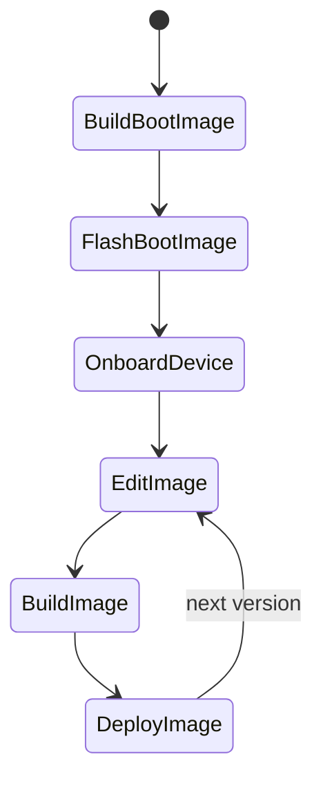

## Getting started

This project shows how to build custom Yocto images which can be deployed to devices.

Whilst the project can be modified to support your own setup, currently the project only includes the configuration required to deploy to the following devices:

* Raspberry Pi 3 and 4 (64 bit variants only)


### General project flow

Below describes the general workflow when using this project to build an image and to deploy the image to a device.

The project flow is as follows:



Where each step is described below:

|Step|Description|
-----|-----------|
|BuildBootImage|Build bootstrap image|
|FlashBootImage|Flash the bootstrap image to the device, e.g. flash the SD card (this is only required once!)|
|OnboardDevice|Register the device once to the cloud so you can enable Over-the-Air (OTA) updates|
|EditImage|Modify your image when new future requirements come up|
|BuildImage|Build a new image which includes the new changes|
|DeployImage|Deploy the image to the device using OTA update|


## Using the project

### Prelude

It is highly recommended to use **Ubuntu 20.04 LTS** for your build (host) machine. If you know what you are doing then you can use another linux distribution, however we cannot help you when things go wrong.

#### Minimum requirements

* At least 100 GB free disk space (however ~500GB is recommended as you don't want to run out and have to set all of this up again)
* x86_64 Machine (arm64/aarch64 is not supported by Yocto)
* Lots of time (first build can take > 6 hours...welcome to the world of yocto)


### Installing the prerequisites

To start off, you will need to install the project and Yocto dependencies.

1. Clone the project and open a console at project's root directory

2. Install just (follow the instructions on the [justfile website](https://just.systems/man/en/chapter_5.html))

3. Install [kas](https://kas.readthedocs.io/en/latest/) (a tool used to managed yocto bitbake projects)

    ```sh
    pip3 install kas
    ```

4. Install the yocto dependencies

    **Ubuntu 20.04 LTS**

    ```sh
    sudo apt install file gawk wget git diffstat unzip texinfo gcc build-essential chrpath socat cpio python3 python3-pip python3-pexpect xz-utils debianutils iputils-ping python3-git python3-jinja2 libegl1-mesa libsdl1.2-dev xterm python3-subunit mesa-common-dev zstd liblz4-tool
    ```

    If you having troubles please consult the [Yocto Documentation](https://docs.yoctoproject.org/scarthgap/brief-yoctoprojectqs/index.html#building-your-image)

**Reducing build times**

You can configure a common **sstate cache** and download folder to share amongst different projects to speed up the build times.

Create the following folders at the desired location, and then add the paths to the local `.env` file located at the root folder of the project (this file is not included in the project).

*file: .env*

```sh
SSTATE_DIR=/data/yocto/sstate-cache
DL_DIR=/data/yocto/downloads
```

### Building an image

Build an image which includes thin-edge.io and [RAUC](https://rauc.readthedocs.io/en/latest/):

**Raspberry Pi**

```sh
KAS_MACHINE=raspberrypi3-64 just build-project ./projects/tedge-rauc.yaml
KAS_MACHINE=raspberrypi4-64 just build-project ./projects/tedge-rauc.yaml
```

Or you can save the KAS_MACHINE value in your .env file

```
KAS_MACHINE=raspberrypi3-64
```

The bootstrap image (which you can flash to an SD card) is located below:

```sh
ls -ltr "build/tmp/deploy/images/$KAS_MACHINE"/*.bz2
```

Where KAS_MACHINE should be replaced with the target machine value, e.g. `raspberrypi4-64`.

### Signing RAUC bundles

RAUC only installs a bundle (`.raucb`) if it is signed by a certificate which chains to a CA in the device's keyring (`/etc/rauc/ca.cert.pem`). The signer and the keyring are configured with the following variables. All values must be absolute paths.

|Variable|Description|
|--|--|
|`RAUC_KEY_FILE`|Private key of the signer, used at build time to sign the bundle. A PKCS#11 URI is also accepted.|
|`RAUC_CERT_FILE`|Certificate of the signer|
|`RAUC_INTERMEDIATE_FILE`|Optional. Intermediate CA certificate(s) which are embedded in the bundle, so the device can build the chain from the signer to the root CA. Separate multiple files with spaces.|
|`RAUC_KEYRING_FILE`|Root CA certificate(s) installed in the image and used by the device to verify bundles during an update. The file can contain multiple PEM certificates, e.g. when rotating CAs.|

The variables are read from the environment (or the `kas/.env` file, see [config/rauc-signing.yaml](./config/rauc-signing.yaml)), and can also be set in `local.conf`.

The build fails if the bundle's signer does not chain to `RAUC_KEYRING_FILE`, so you can't accidentally build an image which rejects your future updates.

#### Development keys (default)

If no signer is configured, the bundle is signed with the development keys in [meta-tedge-rauc/files/pki/development](../meta-tedge-rauc/files/pki/development) and the image trusts the matching development CA. This needs no setup, but the development private key is public, so anyone can create a bundle which these devices will install. The build prints a warning when the development keys are used. Only use them for evaluation.

#### Using your own PKI

The `rauc-create-pki` task creates a PKI with three levels:

|Certificate|Default validity|Used for|Private key|
|--|--|--|--|
|Root CA|20 years|Installed on the device (keyring). Devices trust everything it issues.|Keep offline. Only needed to create a new intermediate CA.|
|Intermediate CA|5 years|Issues signers. Embedded in each bundle.|Keep in a secure place. Only needed to issue new signers.|
|Signer|2 years|Signs the bundles at build time.|Used by the build, e.g. stored as a CI secret.|

Splitting the root and intermediate CAs means the root CA key can stay offline for years, and a leaked intermediate or signer key can be replaced without changing the keyring on the devices. Choose a root CA validity which is at least as long as you plan to support the devices.

Run the following commands from the `kas/` directory (where the `justfile` is located). The `pki` and `.env` paths below are relative to it.

1. Create the PKI for your organization. The settings are added to `kas/.env` automatically.

    ```sh
    cd kas
    just rauc-create-pki --dir pki --org "Acme Inc." --write-env .env
    ```

    The `rauc-create-pki` task accepts the following options:

    |Option|Description|Default|
    |--|--|--|
    |`--dir <path>`|Output directory|`./pki`|
    |`--org <name>`|Organization name used in the certificate subjects. If `--dir` already contains a root CA, the value must match the CA's organization, and it defaults to it.|`Example Org`|
    |`--ca-name <name>`|Common name (CN) of the root CA. If `--dir` already contains a root CA, the value must match the CA's name.|`<org> Firmware Signing CA`|
    |`--intermediate-name <name>`|Common name (CN) of the intermediate CA|`<org> Firmware Signing Intermediate CA`|
    |`--new-intermediate`|Create a new intermediate CA, even if one exists. Requires the root CA key.|not set|
    |`--signer <name>`|Name of the signer, used in the file names and the certificate common name|`signer-1`|
    |`--ca-days <days>`|Validity of the root CA|`7300` (20 years)|
    |`--intermediate-days <days>`|Validity of the intermediate CA. Must not be longer than the root CA's.|`1825` (5 years)|
    |`--signer-days <days>`|Validity of the signer. Must not be longer than the intermediate CA's.|`730` (2 years)|
    |`--key-type <type>`|Key type: `rsa` (RSA 4096) or `ec` (ECDSA P-256)|`rsa`|
    |`--write-env <file>`|Append the `RAUC_*` settings to the given file. Existing `RAUC_*` settings are never overwritten.|not set|

    If you pass any options, the defaults of the `just` task (`--dir pki --write-env .env`) are replaced, so include them if you need them. For example, to choose the CA names and use ECDSA keys:

    ```sh
    just rauc-create-pki --dir pki --org "Acme Inc." \
        --ca-name "Acme Device Firmware CA" \
        --intermediate-name "Acme Device Firmware Intermediate CA 2026" \
        --key-type ec --write-env .env
    ```

    The task creates the following files (the `kas/pki` folder is ignored by git):

    |File|Description|
    |--|--|
    |`pki/ca.cert.pem`|Root CA certificate, installed on the device. Subject: `O=Acme Inc., CN=Acme Inc. Firmware Signing CA`|
    |`pki/private/ca.key.pem`|Root CA private key. Move it to offline storage, see [Protecting the CA private keys](#protecting-the-ca-private-keys).|
    |`pki/intermediate.cert.pem`|Intermediate CA certificate, embedded in the bundles. Subject: `O=Acme Inc., CN=Acme Inc. Firmware Signing Intermediate CA`|
    |`pki/private/intermediate.key.pem`|Intermediate CA private key. Only needed to issue new signers.|
    |`pki/signer-1.cert.pem`|Signer certificate. Subject: `O=Acme Inc., CN=Acme Inc. signer-1`|
    |`pki/private/signer-1.key.pem`|Signer private key. Store it securely, e.g. as a CI secret.|

    And adds the following settings to `kas/.env` (with absolute paths):

    ```sh
    RAUC_KEY_FILE=/path/to/meta-tedge/kas/pki/private/signer-1.key.pem
    RAUC_CERT_FILE=/path/to/meta-tedge/kas/pki/signer-1.cert.pem
    RAUC_INTERMEDIATE_FILE=/path/to/meta-tedge/kas/pki/intermediate.cert.pem
    RAUC_KEYRING_FILE=/path/to/meta-tedge/kas/pki/ca.cert.pem
    ```

    If you already have a PKI, set the `RAUC_*` variables to your existing files instead. Leave `RAUC_INTERMEDIATE_FILE` empty if your signer is issued directly by the root CA.

2. Check the certificates. The signer must chain to the root CA, otherwise the build fails.

    ```sh
    openssl x509 -in pki/ca.cert.pem -noout -subject -dates
    openssl x509 -in pki/intermediate.cert.pem -noout -subject -issuer -dates
    openssl x509 -in pki/signer-1.cert.pem -noout -subject -issuer -dates
    openssl verify -CAfile pki/ca.cert.pem -untrusted pki/intermediate.cert.pem pki/signer-1.cert.pem
    ```

    The last command prints `pki/signer-1.cert.pem: OK`.

3. Move the root CA private key to offline storage, as described in [Protecting the CA private keys](#protecting-the-ca-private-keys).

4. Build the project as usual. The `RAUC_*` settings are read from `kas/.env`.

    ```sh
    just build-project ./projects/tedge-rauc.yaml
    ```

    The build no longer prints the warning about the development key.

5. Flash the image. The device now only accepts bundles signed by a signer which chains to your root CA.

    You can check the configuration on the device with:

    ```sh
    sed -n '/\[keyring\]/,/^\[/p' /etc/rauc/system.conf
    rauc info /path/to/bundle.raucb
    ```

    If a bundle is signed by an untrusted signer, `rauc install` fails with a signature verification error and the thin-edge.io `firmware_update` operation is marked as failed. The device keeps running the current image.

#### Certificate validity and expiry

The images set `use-bundle-signing-time=true` in RAUC's `system.conf`. RAUC then checks that all certificates were valid when the bundle was signed, instead of checking them against the device's clock. This means:

* A bundle stays installable after its signer expires. For example, a device which was offline for a long time can still install a bundle which was signed while the signer was valid.
* Devices without a real-time clock (such as the Raspberry Pi) can verify bundles before NTP has synchronized.
* The build refuses to sign with an expired signer, so new bundles always need a valid signer.

Plan for the following:

* **Signer expires (every 2 years):** issue a new signer before the old one expires, see [Adding or replacing a signer](#adding-or-replacing-a-signer). No device update is needed.
* **Intermediate CA expires (every 5 years):** create a new intermediate CA and signer before it expires. No device update is needed, as the new intermediate CA is embedded in the bundles.
* **Root CA expires (after 20 years):** devices can't verify bundles signed after the root CA expires, so replace the root CA on the devices well before then, see [Rotating or changing the CA](#rotating-or-changing-the-ca).

Since the validity is checked at the signing time, a leaked signer key could be used to sign bundles with a backdated signing time, even after the signer has expired. If a key is leaked, replace the CA it was issued by (or revoke it with a CRL, see the [RAUC documentation](https://rauc.readthedocs.io/en/latest/reference.html#keyring-section)).

To check the validity against the device's clock instead, set the following in your `local.conf`. In this case, all certificates must be valid for the whole time the devices install updates, and the devices need a correct clock.

```
TEDGE_RAUC_USE_BUNDLE_SIGNING_TIME = "false"
```

#### Adding or replacing a signer

To issue another signer from the same intermediate CA (for example, one per build system, or to replace a signer before it expires), run the task again with the same `--dir` and a new signer name. The existing CAs are reused, so devices accept bundles from all signers. The signer gets the CA's organization, and the task fails if you pass a different `--org` (use another `--dir` to create a PKI for another organization).

```sh
just rauc-create-pki --dir pki --signer signer-2
```

The `.env` file is not updated, as it already contains `RAUC_*` settings. To build with the new signer, change the following lines in `kas/.env`:

```sh
RAUC_KEY_FILE=/path/to/meta-tedge/kas/pki/private/signer-2.key.pem
RAUC_CERT_FILE=/path/to/meta-tedge/kas/pki/signer-2.cert.pem
```

`RAUC_INTERMEDIATE_FILE` and `RAUC_KEYRING_FILE` stay the same.

#### Replacing the intermediate CA

Create a new intermediate CA before the current one expires, or if its key is leaked. This needs the root CA private key (see [Protecting the CA private keys](#protecting-the-ca-private-keys) for how to restore it temporarily):

```sh
just rauc-create-pki --dir pki --new-intermediate --signer signer-3
```

The previous intermediate CA is kept as `pki/intermediate.<date>.cert.pem`. Update `RAUC_KEY_FILE` and `RAUC_CERT_FILE` in `kas/.env` to the new signer. `RAUC_INTERMEDIATE_FILE` already points to the new intermediate CA (`pki/intermediate.cert.pem`). `RAUC_KEYRING_FILE` stays the same, so no device update is needed.

#### Protecting the CA private keys

The root CA private key (`pki/private/ca.key.pem`) controls what your devices trust. Anyone who has it can create their own intermediate CA and signers, and install their own software on your devices. It is only needed to create a new intermediate CA (about every 5 years), so keep it offline:

1. Create an encrypted copy of the key. You are asked for a passphrase.

    ```sh
    openssl pkey -in pki/private/ca.key.pem -aes256 -out ca.key.enc.pem
    ```

2. Store `ca.key.enc.pem` and the passphrase separately in a safe place, for example the encrypted file on offline media (with a backup) and the passphrase in your password manager. Keep `pki/ca.cert.pem` with it. The CA certificate is public, so it doesn't need protecting.

3. Delete the unencrypted key and the encrypted copy from the build machine.

    ```sh
    rm pki/private/ca.key.pem ca.key.enc.pem
    ```

To create a new intermediate CA later, restore the key temporarily, run `rauc-create-pki` with the same `--dir`, then delete the key again:

```sh
openssl pkey -in /path/to/ca.key.enc.pem -out pki/private/ca.key.pem
just rauc-create-pki --dir pki --new-intermediate --signer signer-3
rm pki/private/ca.key.pem
```

The intermediate CA private key (`pki/private/intermediate.key.pem`) is needed to issue new signers. Protect it in the same way if you only issue signers occasionally, or keep it on a secure machine which is not used for builds.

If a key is lost:

* **Root CA key:** existing intermediate CAs and signers keep working until they expire, but you can't create new intermediate CAs. Replace the root CA on the devices before the intermediate CA expires.
* **Intermediate CA key:** create a new intermediate CA with the root CA key.

If a key is leaked:

* **Signer or intermediate CA key:** create a new intermediate CA and signer. As devices still trust bundles signed by the leaked key, also replace the root CA on the devices (or revoke the leaked certificate with a CRL).
* **Root CA key:** replace the root CA on the devices as described in [Rotating or changing the CA](#rotating-or-changing-the-ca).

#### Rotating or changing the CA

The keyring is part of the image, so changing the root CA takes one update:

1. Build an image with `RAUC_KEYRING_FILE` set to the new root CA. To support both CAs during a transition, set it to a file which contains both certificates (`cat old-ca.cert.pem new-ca.cert.pem > keyring.pem`).
2. Sign the bundle so that devices running the current image accept it, which means using a signer from the **old** PKI. If the new image was built with a signer from the new PKI, re-sign the bundle with the old signer:

    ```sh
    rauc resign \
        --keyring=new-ca.cert.pem \
        --signing-keyring=old-ca.cert.pem \
        --cert=old-signer.cert.pem \
        --key=old-signer.key.pem \
        --intermediate=old-intermediate.cert.pem \
        new-image.raucb transition.raucb
    ```

    Leave out `--intermediate` if the old signer is issued directly by the old root CA (as with the development keys). If the bundle was signed by a signer which has expired since, add `--no-check-time`. If `rauc resign` fails with "bundle is stored on an unsafe filesystem" (e.g. on a network or container mount), copy the bundle to a local filesystem first, or add `--trust-environment`.

    `rauc` is available on most Linux distributions (e.g. `apt-get install rauc`), or from the build with `kas shell ./projects/tedge-rauc.yaml -c 'bitbake rauc-native -c addto_recipe_sysroot && oe-run-native rauc-native rauc resign ...'`.

3. Install `transition.raucb` on the devices. Once updated, they only accept bundles signed by the new PKI (or both, if you used a combined keyring).

This is also how to move devices which run an image with the development keys over to your own PKI, using the development signer in [meta-tedge-rauc/files/pki/development](../meta-tedge-rauc/files/pki/development) as the "old" signer.

#### Signing in CI

The [build workflow](../.github/workflows/build.yaml) signs the RAUC bundles with your signer when the following repository settings exist. Otherwise it uses the development keys and shows a warning. Pull requests always use the development keys, as forks don't have access to secrets.

|Setting|Type|Content|
|--|--|--|
|`RAUC_SIGNING_KEY`|Secret|Signer private key (PEM)|
|`RAUC_SIGNING_CERT`|Variable|Signer certificate (PEM)|
|`RAUC_INTERMEDIATE`|Variable|Intermediate CA certificate(s) (PEM). Optional, if the signer is issued directly by the root CA.|
|`RAUC_KEYRING`|Variable|Root CA certificate(s) installed on the device (PEM)|

The certificates are public, so they are stored as variables, which you can read back to check them. Only the signer private key is a secret. The CA private keys are never uploaded.

To upload them with the [GitHub CLI](https://cli.github.com/), you need admin access to the repository:

1. Log in, and run the commands from the `kas/` directory of a clone of the repository which runs the builds (e.g. your fork). To target another repository, add `--repo <owner>/<repo>` to each `gh` command.

    ```sh
    gh auth login
    cd kas
    ```

2. Create a dedicated signer for CI, so you can replace it without affecting other build systems.

    ```sh
    just rauc-create-pki --dir pki --signer ci-1
    ```

3. Upload the signer and the CA certificates.

    ```sh
    gh secret set RAUC_SIGNING_KEY < pki/private/ci-1.key.pem
    gh variable set RAUC_SIGNING_CERT < pki/ci-1.cert.pem
    gh variable set RAUC_INTERMEDIATE < pki/intermediate.cert.pem
    gh variable set RAUC_KEYRING < pki/ca.cert.pem
    ```

4. Check the settings. The secret's value can't be read back, but it should be listed.

    ```sh
    gh secret list
    gh variable get RAUC_SIGNING_CERT | openssl x509 -noout -subject -issuer -enddate
    gh variable get RAUC_INTERMEDIATE | openssl x509 -noout -subject -issuer -enddate
    gh variable get RAUC_KEYRING | openssl x509 -noout -subject
    ```

5. Delete the local copy of the CI signer key.

    ```sh
    rm pki/private/ci-1.key.pem
    ```

6. Start a build, and check that the "Configure RAUC signing" step prints `signer.cert.pem: OK` and doesn't show the "RAUC development keys" warning.

    ```sh
    gh workflow run build.yaml --ref <branch>
    gh run watch
    ```

    Then check a bundle from the build artifacts against your root CA (on a Linux machine with `rauc` installed):

    ```sh
    rauc info --keyring=pki/ca.cert.pem core-image-tedge-rauc-*.raucb
    ```

To replace the CI signer (e.g. before it expires), issue a new signer and run the commands in step 3 again with the new files. When you replace the intermediate CA, also update `RAUC_INTERMEDIATE`. `RAUC_KEYRING` only changes when you change the root CA.

### Publishing the OTA image file to Cumulocity IoT


Publish/upload the built image to Cumulocity IoT (requires [go-c8y-cli](https://goc8ycli.netlify.app/) to be installed and a session to be active)

```sh
set-session "your_session"
just publish
```

## Development Tasks

### Updating yocto layers

The projects use lock files in order to create reproducible builds by fixing layers to specific commits. Therefore if you need to update them, then run the following task:

```sh
just update-all-locks
```

Or you can specify which project file should be updated instead (if you want more control over it).

```sh
just update-lock ./projects/tedge-rauc.yaml
```

## Tips

### Unexpected build errors

If you run into unexpected build errors, or the image just doesn't include the expected contents, then try running the following task, then build again.

```sh
just clean
```

Or if you are still having problems, try removing all of the temp folders (build and the repositories)

```sh
just clean-all
```
